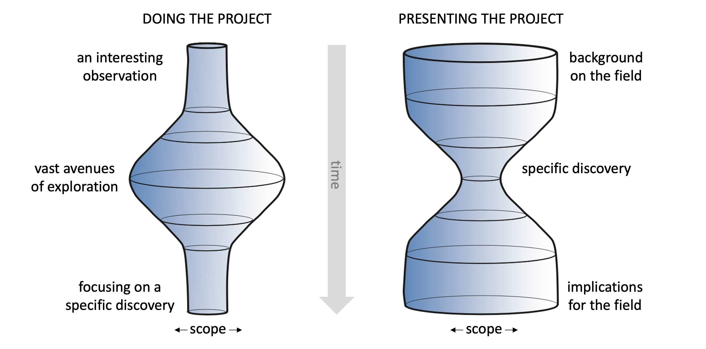

---
metaLinks:
  alternates:
    - /broken/spaces/mzd6xx2kCQ8dn7PxnBoD/pages/yHNi3OcaTLBrZEjvrTf9
---

# 👩‍🎤 Communicating your research

Presenting your work is a key part of being a scientist, and it requires careful thought, preparation, and practice to imagine the audience and take them on a journey from where they are to where you want to get them to.

Here is a useful image from [Itai Yanai](https://twitter.com/ItaiYanai) that helps depict a key difference between doing science and communicating science:

<figure><figcaption></figcaption></figure>

## Making posters

[A video](https://youtu.be/1RwJbhkCA58) on how to construct a good poster for a large conference. Includes some great insights into the conference attendee experience.

## Making presentations

* [Keynote](https://www.apple.com/keynote/) is very nice to use, but is only for Mac, and doesn't allow version control.
* [Powerpoint](https://office.live.com/start/powerpoint.aspx), you know it.
* [Deckset](https://www.deckset.com/) is a nice way to make presentations in markdown, but is only for Mac.
* [Marp](https://marp.app) allows markdown-based presentations, enabling very quick slide preparation, easy embedding of code and hyperlinks, and version control.
* If you wanna blow the socks off of your audience, this is a nice tool for making animated plots [https://extensions.blender.org/add-ons/scigraphs/](https://extensions.blender.org/add-ons/scigraphs/)
